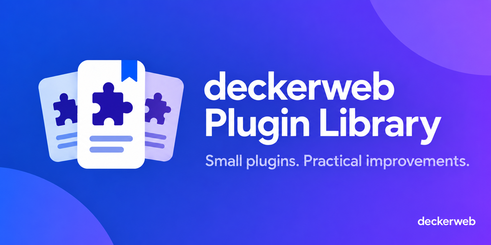
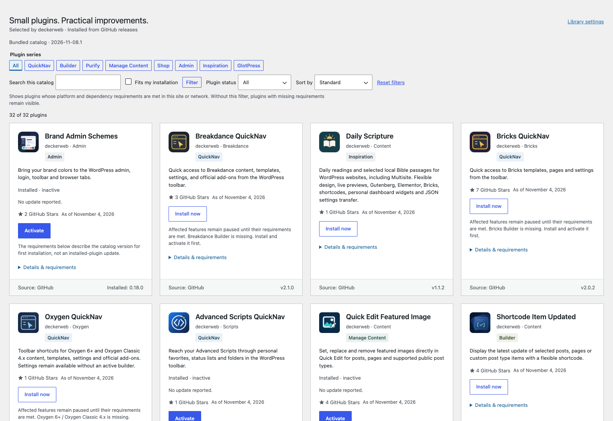
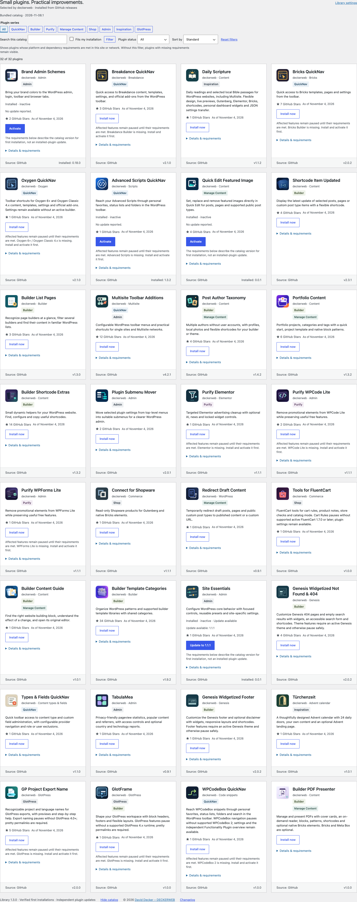

# deckerweb Plugin Library

[Deutsch](README-de.md)



## About

The deckerweb Plugin Library adds a selected catalog of deckerweb plugins to WordPress. It comes bundled with certain plugins and gives you another way to discover and install useful additions under **Plugins → Add New → deckerweb**. The usual WordPress.org catalog remains the default.

If you found an `includes/deckerweb-plugin-library/` folder inside a plugin, this is the shared component behind that catalog. The plugin author included it deliberately; you do not need to install or configure a separate Library plugin.

This repository contains the reusable PHP component, catalog, integration examples and documentation. It is also open for developers who want to read the code, reuse it under its license or build their own approach.

Installation and activation happen directly in the selected card. Status and errors appear there; search, series filters and scroll position remain. Filesystem credentials use the native WordPress dialog. Without JavaScript, the checked form workflow remains available.

Component: **Library 1.3.0**. See the [website](https://deckerwebplugins.com/en/library/), [catalog](docs/CATALOG.md) and [validation](docs/VALIDATION-1.3.0.md).

Current online catalog: **2026-11-08.1 · 32 plugins · eight series**. Library component: **1.3.0**. Catalog discovery and first installation are separate from ordinary installed-plugin updates.

**Version:** 1.3.0 · WordPress ≥ 6.4 · PHP ≥ 8.0

[Documentation](docs/INTEGRATION.md) · [FAQ by topic](docs/FAQ.md) · [Security](SECURITY.md)

## The Library in WordPress



Combine series, search and plugin status in a compact toolbar. Your preferences are saved per user.



The catalog with 32 approved plugins and their local original icons. Screenshots show Library 1.3.0 and catalog revision 2026-11-08.1; available versions can change.


## Contents

- [At a Glance](#at-a-glance)
- [Installation](#installation)
- [Features](#features)
- [For plugin users](#for-users)
- [For developers](#for-developers)
- [FAQ](#faq)
- [Changelog](#changelog)
- [Author and scope](#author)
- [Support](#support)

<a id="at-a-glance"></a>
## At a Glance

- Selected public GitHub releases with local icons and clear requirements.
- Search, series and status filters, personal sorting and matching result counts.
- Optional daily online catalog; independent installed-plugin update checks.

<a id="installation"></a>
## Installation and first steps

See [integration](docs/INTEGRATION.md), [data](docs/DATA.md), [tests](docs/TESTING.md) and [security](SECURITY.md).

[Series and filters](docs/SERIES.md).

<a id="features"></a>
## Main features

### Discover suitable plugins

Use Plugins → Add New → deckerweb. Combine search, any available series, plugin status and Fits my installation. Each card explains requirements and safe-pause notices; installation and activation remain separate.

### Approved catalog updates

The public GitHub catalog address is prefilled. Enable online retrieval in Library settings. Discovery is cached for 24 hours. Approved plugin releases can change without replacing Library code. [Catalog guide](docs/CATALOG.md).

### Shared preferences and safe packages

Installed hosts share settings; deactivation preserves data. Fresh release approval, checksums and archive checks guard first installations; installed updates use their normal updater. [Data](docs/DATA.md) · [Updater integration](docs/UPDATER.md).

### Personal filters and clear status

Choose Standard, Name A–Z, Name Z–A, Recently updated or Discover randomly in the catalog. Your view is saved per WordPress user; Shuffle again changes the random order. Filters remain available when returning. Library settings contain expandable Technical information with a copy button. No credentials or site content are included. Git Updater conflicts are detected locally; a targeted notice explains temporary deactivation when needed.

Combine search, series, installation compatibility and Plugin status. Choose All, Not installed, Installed, Active, Inactive or Update available. Status uses the current site or network context. Update available uses existing WordPress offers for installed plugins, independently of catalog versions. No update reported does not claim a fresh release check. The result count reflects all selected filters. Reset filters clears search and filters while keeping the personal sort order. Preferences are stored per user. Successful inline actions refresh matching cards; failed actions remain visible. No additional GitHub requests are needed for filtering. Catalog origin and revision are shown above the controls.

Catalog actions identify failed request and verification stages without displaying remote response bodies, credentials or private paths.

[Illustrative catalog diagram](assets-github/banner-en.png)


<a id="for-users"></a>
## Found this Library in your plugin?

### You choose what gets installed

The catalog shows selected public GitHub releases, their requirements and any missing dependencies. Opening a card does not install anything. You start installation yourself; activation is a separate step. Required third-party plugins are not installed automatically.

You can hide the catalog in **Settings → deckerweb Library**, or in the network settings on Multisite. Hiding it keeps already configured update handling intact. If several installed plugins include the Library, they share one catalog and its settings rather than adding several copies of the interface.

### External connections are explained

The bundled catalog and its icons can be displayed locally. Optional online catalog retrieval is **off by default**. When enabled, it reads the public catalog from GitHub and caches discovery results for 24 hours; you can also refresh manually. Installing a selected plugin downloads its approved GitHub ZIP. First installations in online mode check approval again. Installed-plugin updates use their normal updater independently.

These requests let the serving endpoint see the requesting IP address. The Library does not send your site URL, user ID or plugin inventory and has no telemetry. Existing plugin updaters may make their own requests according to the host plugin's documentation. Public catalog retrieval and public package downloads do not require a GitHub account or user token.

### Checks before installation

The Library checks WordPress/PHP requirements, declared dependencies, the approved package identity, checksum and archive structure. These checks help reject unexpected packages; they are not a promise that every plugin is suitable for every site. Review the plugin's own documentation and use your normal backup and staging workflow.

Deactivating an embedding plugin preserves shared Library settings. Properly integrated hosts clean up temporary Library data when the last host is uninstalled; deleting settings is optional. Plugins installed through the catalog and their content remain. See [data ownership and cleanup](docs/DATA.md).

<a id="for-developers"></a>
## For developers: explore, reuse, adapt

The Library is **GPL-2.0-or-later**. You are welcome to study, reuse and adapt the code under that license. Keep copyright and required provenance notices, and check the separate [artwork notes](docs/ASSETS.md) before reusing graphics or branding.

### Start with the integration contract

The component requires **WordPress 6.4+ and PHP 8.0+**, with **ZipArchive** for package installation. A host plugin or catalog entry may have higher requirements. Copy only `lib/` into the host's `includes/deckerweb-plugin-library/` folder, then register it before `plugins_loaded`:

```php
require_once __DIR__ . '/includes/deckerweb-plugin-library/bootstrap.php';
deckerweb_library_register_v2(
    __FILE__,
    [],
    __DIR__ . '/includes/deckerweb-plugin-library'
);
```

This is the starting point, not the entire integration. Follow the [integration guide](docs/INTEGRATION.md) for the required uninstall contract, host-domain translations and mixed-copy checks. Preserve the host's own updater; the [catalog bridge](docs/UPDATER.md) is an optional integration. Ship the runtime, not the authoring tools or this whole repository. The current Library and deckerweb Updater are excluded from WordPress.org builds; use this kit for direct distribution.

### A useful reading path

- [`lib/bootstrap.php`](lib/bootstrap.php): registration and selection of one compatible runtime across hosts.
- [`lib/src/Catalog.php`](lib/src/Catalog.php): catalog validation, source restrictions and independent caches.
- [`lib/src/Requirements.php`](lib/src/Requirements.php) and [`lib/src/Package.php`](lib/src/Package.php): prerequisites, package verification and bounded archive processing.
- [`lib/lifecycle.php`](lib/lifecycle.php): shared data ownership and cleanup after the final host.
- [`tools/refresh-catalog.py`](tools/refresh-catalog.py) and [`tools/approve-catalog.py`](tools/approve-catalog.py): prepare a candidate, review it and export the exact approved bytes. Publication remains a separate operator action.

### Building your own catalog

The shipped implementation is intentionally restricted to approved deckerweb repositories and catalog sources. It is not an unrestricted repository installer: pointing it at an arbitrary JSON URL is insufficient. For another publisher, deliberately adapt and test source restrictions, repository identities, package rules, series, translations and shared-runtime ownership. Avoid namespace/bootstrap collisions if your adaptation can run beside deckerweb plugins.

Keep catalog metadata separate from component releases, cache discovery rather than querying GitHub on every page view, and check package approval freshly before sensitive actions. Preserve independent host update paths. See the [catalog guide](docs/CATALOG.md), [test guide](docs/TESTING.md) and [release conventions](docs/CONVENTIONS.md). Ideas and implementation questions are welcome in this repository's Issues and Discussions; private security reports about an embedded copy belong in its host plugin repository.


## FAQ

### Where is the catalog?

Open Plugins → Add New → deckerweb. WordPress.org remains the default view.

### Does the online catalog limit plugin updates?

No. With Library 1.3.0 and Updater 2.4.0, installed plugins use their normal WordPress update provider regardless of catalog settings or catalog version. The Library shows the actual installed version and existing WordPress update offers. A catalog version only selects the verified package for first installation. No additional GitHub release checks are made when browsing. Normal update intervals, caches and technical requirements still apply. This does not enable automatic installation. Older component combinations may retain their previous behavior until updated. See the [update guide](docs/CATALOG.md#plugin-updates-and-the-online-catalog).

### Why is an installation unavailable?

Check the card for WordPress/PHP requirements and the selected release. Missing mother plugins or themes are advisory for catalog versions with a verified safe-pause rule: installation and activation remain available while dependent features pause. Older installed versions may still have required dependencies. Native WordPress restrictions and platform requirements remain effective. Prerequisites are not installed automatically; activation is separate.

### Can I hide it?

Use Settings → deckerweb Library (Network Settings on Multisite). Hiding the catalog preserves dependency checks and ordinary plugin updates. Online retrieval is a separate preference for catalog metadata and first installations.

### What happens when I remove a host?

Another installed host, even inactive, preserves shared data. The final host removes temporary Library data and caches. Settings remain unless optional deletion was enabled. Installed plugins and their content remain. Hosts must call the supplied uninstall contract.

### Does it support Multisite?

Library settings apply per network; catalog preferences are personal. Plugin actions respect site/network permissions and each catalog entry. Multisite Toolbar Additions supports single sites and Multisite. Daily Scripture permits network activation from version 1.0.0. The current Bricks QuickNav catalog version has no blanket per-site activation block; its theme-dependent features still depend on each site’s active theme. See the validation guide for the actual tested scope.

### How do I report a vulnerability?

Use Security → Advisories → Report a vulnerability in the host plugin repository. Include host and Library versions; do not post security details in public issues. Hosts must enable private reporting before publication.

[Complete FAQ by topic](docs/FAQ.md).

<a id="changelog"></a>
## Changelog

### 1.3.0 · 2026-11-08

- **New:** Installed-plugin updates are independent of online catalog settings and catalog versions.
- **Improved:** Cards show actual installed versions and normal WordPress update offers, including newer releases than the catalog.
- **Improved:** Updated approved bundled catalog and local original icons.
- **Fixed:** Retire stale catalog-managed update offers and verify installed identity before explicit updates.
- **Fixed:** Check installed-version requirements when activating an existing plugin.
- **Fixed:** Keep parallel installation and temporary-file records independent and reliably clean owned first-installation files after failures.
- **Misc:** Older plugins without a normal update provider need a one-time manual ZIP update; the Library no longer supplies catalog-managed update offers.

### 1.2.0 · 2026-10-30

- **New:** Filter plugins by installation, activation and available catalog updates, with matching result counts.
- **Improved:** Plugin status and matching results refresh after successful catalog actions. Reset filters keeps the personal sort order.
- **Improved:** Updated bundled catalog and local original icons.
- **Improved:** Catalog and download failures identify the failed stage and a safe connection, HTTP, checksum or archive cause.
- **Improved:** More compact catalog filters retain familiar WordPress controls and keyboard focus.
- **Fixed:** Catalog actions remain inline after changing filters or sorting.

### 1.1.0 · 2026-10-21

- **Improved:** Updated approved catalog and local original icons, with fewer duplicate image files. Initials use consistent subtle background colors; cards highlight on hover and keyboard focus.
- **Fixed:** Stricter normalization of administration inputs and contextual protection of catalog output.
- **Fixed:** Inline updates work with Git Updater nonce checks without weakening Library authorization; failed actions retain their error styling.
- **Fixed:** Explicit catalog updates recognize matching GitHub source-archive offers while installing only the approved, checksum-verified release asset.

### 1.0.0 · 2026-10-15

- **New:** Personal catalog sorting, stable random discovery and copyable technical information in Library settings.
- **Improved:** Remembered filters, clearer catalog provenance and plugin activation states, refreshed approved releases and local original icons.
- **Fixed:** Inline installation supplies native plugin identity for Git Updater compatibility. Changelog dialogs retain native close and documentation-link fallbacks.

### 0.9.0 · 2026-10-10

- **New:** Update verified installed catalog plugins directly in their cards, including older releases without an updater.
- **New:** Catalog-defined series, localized categories, ordering and versioned safe-pause dependency rules.
- **Improved:** Current approved catalog packages and local original icons, including Builder Content Guide and the Admin series.
- **Improved:** Save shared preferences in place and keep Library operations inside WordPress administration.
- **Fixed:** Early fallback messages use host translation resources; activation handoff documentation is directly attached to the function.

### 0.8.1 · 2026-10-08

- **New:** Tools and Shop catalog series, with backward-compatible metadata.
- **Improved:** The bundled catalog includes all 20 approved plugins and their current local icons.
- **Improved:** Check the plugin status after interrupted inline actions without repeating a successful operation.
- **Improved:** Match builder runtime markers to the active installation and apply the versioned Oxygen QuickNav 2.0 activation contract.
- **Improved:** Updated Oxygen QuickNav2.0.0 and Quick Edit Featured Image1.4.0 packages, requirements and original icons.
- **Fixed:** Final-host uninstall removes current catalog and update caches as well as legacy caches.
- **Fixed:** The current uninstall entry point remains effective when an older cleanup copy was loaded first.

### 0.7.0 · 2026-10-07

- **Improved:** Install and activate catalog plugins directly in their cards, with inline status and errors.
- **Improved:** Use the approved three-character fallback labels when no original icon is available.

[ Complete changelog ](docs/CHANGELOG.md)

<a id="author"></a>
## Author and scope

Developed and published by David Decker — DECKERWEB. A shared embedded component for direct-distribution plugins, not a standalone WordPress.org plugin.

<a id="support"></a>
## Issues, security and support

Use the embedding host repository for ordinary issues and questions, and its private reporting channel for security details. [Security policy](SECURITY.md).

[Ko-fi](https://ko-fi.com/deckerweb) · [Buy Me a Coffee](https://buymeacoffee.com/daveshine) · [PayPal](https://paypal.me/deckerweb)

## Copyright & License

Copyright © 2026 David Decker — DECKERWEB. GPL-2.0-or-later. [License](LICENSE) · [Artwork and provenance](docs/ASSETS.md).
